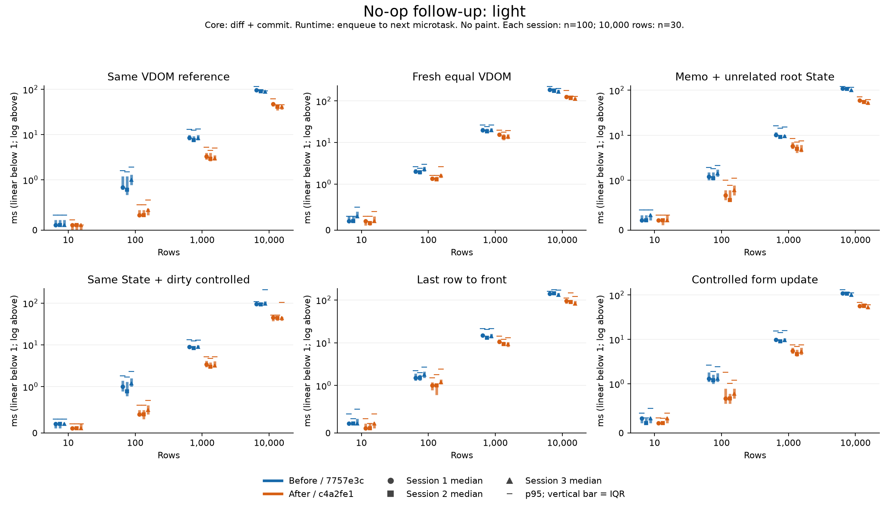
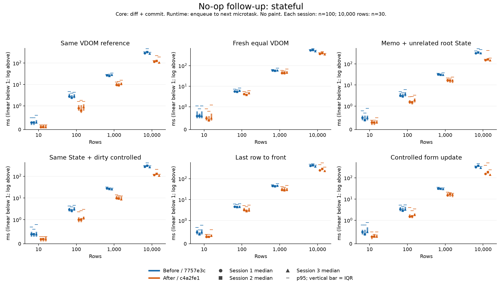
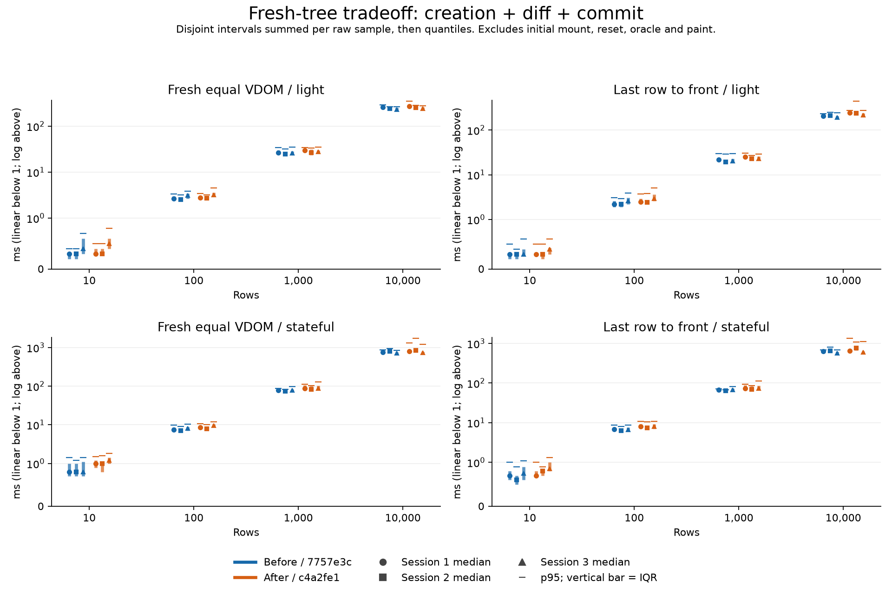

# 성능 결과: 브라우저 안정화와 no-op 후속 개선

현재 기능 소스는 **c4a2fe1**이다. 같은 하네스로 3독립 세션을 실행해 대규모 no-op의 **갱신 구간** 감소를 확인했다. 다만 **새 VDOM 생성까지 포함하면 더 느린 조건이 있고**, 폼 변경·재배치의 일부 p95도 악화됐다. 이 두 한계를 포함해 해석한다.

최초 M8의 Greedy/LIS·Batching·expression 재사용 실험은 [당시 보고서](benchmark-results-m8.md)와 [m8-full 원본](bench/m8-full/environment.json)에 보존했다. 그 기능 소스는 3190268이며 새 코드의 결과로 바꾸지 않았다. m7-full의 과거 실패 원본도 그대로 남아 있다.

## 비교 버전과 환경

| 항목 | 값 |
|---|---|
| 기준선 | baseline-v1 / 7757e3c; 엔진은 후속 목표 시작 9f3f3d3과 동일 |
| 개선 | candidate-v1 / c4a2fe1; host 비교 할당 제거 + 증명된 불변 전체 root 검증 재사용 |
| 엔진 SHA256 전 → 후 | 1e42089a7970b7458b24377d2242c035abbcc10cee8d368f239ac9e0dbbd5ff1 → fffff850c0f88407a6eb0f5da5d466809cb3e8bf19071827120d0955c396bc3c |
| 동일 하네스 SHA256 | 1028db69131c6fdc4a5497bf214d4715f4fae925f2d63e47946cbe883b83c7ff |
| 실행 | 2026-11-07 21:38:30–22:25:31 KST, 47.03분 |
| 환경 | Node 24.22.1, Windows 10 Pro 19045 x64, i7-10875H / 16 logical CPU / 15.79 GiB, Chromium 151.0.7922.34 headless 1280×900 |
| 빌드 | Vite production / minify oxc / 고정 asset SHA; static HTTP, HMR 없음 |
| 전원·부하 | 균형 조정, 설정 변경 없음. 전체 테스트·빌드 동시 실행 없음. 문서와 가벼운 분석은 병행. OS background/열 상태는 완전 통제하지 못함 |

[환경·빌드·원본 SHA](bench/noop-full/environment.json), [로컬 조건](bench/noop-full/local-conditions.json). 각 세션에서 48개 조건마다 새 Chromium을 띄웠다. 엔진별 page/module realm, 표본별 fresh mount/DOM, seed 539365639, paired 교대 순서와 세션 2의 조건 역순을 사용했다. 모든 측정은 visible/focused였고 실패·자동 재시도·표본 제거는 없었다.

10/100/1,000/10,000 × light/stateful × 6경로 × 3세션이다. 일반 조건은 엔진별 warm-up 20 + 측정 100, 10,000개는 5 + 30이다. counts를 별도로 실행했다. **counts 288 + warm-up 4,680 + 측정 23,760 = raw 28,728개**, 구간 통계 **2,016개**를 원본에서 재계산했다. [감사](bench/noop-full/analysis.json)는 조건 누락/중복·oracle·통계 일치·세션/엔진 간 counts 일치를 확인한다.

core cycle은 diff+commit, runtime cycle은 enqueue→다음 microtask다. render/diff/commit/flush는 중첩 구간이므로 모두 더하지 않는다. target 표현/VDOM 생성은 core cycle 밖의 별도 구간이다. mount/reset/사용자 입력 seed/정답 검사/프로세스 시작은 측정 밖이다. dirty controlled는 이미 관찰한 live 값/dirty map을 준비해 같은 State setter로 복원한다. native 이벤트 순서는 별도 브라우저 테스트가 확인한다. 기존 fixture/핵심 cycle 경계는 공유하지만 이 하네스는 기존 m8의 capture 단계를 포함하지 않으므로 두 보고서의 절대 시간을 직접 전후 비교하지 않는다. paint 측정은 아니다.

## 갱신 시간

10,000개 stateful 목록. 아래 모든 셀은 **S1 / S2 / S3**, 단위 ms, 감소율은 해당 세션 쌍의 median 기준이다. 세션을 한 분포로 합치지 않았다.

| 경로 | 기준선 median | 개선 median | 감소율 |
|---|---|---|---|
| 같은 VDOM 참조 | 288.60 / 323.10 / 275.10 | 115.95 / 123.80 / 105.65 | 59.82 / 61.68 / 61.60% |
| 동등한 새 VDOM | 557.40 / 582.15 / 503.50 | 379.90 / 406.85 / 357.40 | 31.84 / 30.11 / 29.02% |
| Memo + 무관한 루트 State | 322.40 / 348.05 / 317.10 | 151.60 / 161.40 / 145.50 | 52.98 / 53.63 / 54.12% |
| 같은 State + dirty controlled | 278.15 / 304.60 / 260.55 | 113.90 / 128.60 / 105.80 | 59.05 / 57.78 / 59.39% |
| 마지막 행 → 처음 | 414.55 / 430.65 / 382.60 | 255.25 / 290.80 / 236.70 | 38.43 / 32.47 / 38.13% |
| controlled 값 변경 | 316.65 / 373.70 / 296.45 | 155.40 / 185.00 / 140.95 | 50.92 / 50.50 / 52.45% |

네 no-op 경로의 큰 stateful cycle median은 세 세션 모두 감소했다. 같은 참조 약 60–62%, 동등한 새 트리 약 29–32%, Memo 약 53–54%, dirty controlled 약 58–59%다. 두 회귀 경로의 중앙값도 감소했다. 전체 144개 조건/세션 비교에서 median 증가 사례는 없었으나 작은 값의 동일/미세한 차이를 확정적 향상으로 해석하지 않는다.

**10/100/1,000/10,000의 두 payload·모든 경로·각 세션 median/IQR/p95/n**은 [전체 표](bench/noop-full/all-results.md), [CSV](bench/noop-full/summary.csv), [통계 JSON](bench/noop-full/summary.json)에 있다. 특히 10개 목록은 0.1ms 수준 해상도와 잡음의 영향을 크게 받으므로 큰 백분율만 인용하지 않는다.





## 불리한 결과: 새 트리 생성과 p95

불변성을 안전하게 증명하는 최초 순회/descriptor 검사/동결/WeakSet 등록에 비용이 든다. **각 raw 표본의 expressionMs + cycleMs를 먼저 합한 뒤** quantile을 계산했다. 두 median을 더한 값이 아니며, initial mount와 paint는 여전히 제외한다.

| 10,000개 조건 | 기준선 생성+cycle median (S1/S2/S3) | 개선 median (S1/S2/S3) | 증가율 |
|---|---|---|---|
| light / 동등한 새 VDOM | 256.55 / 242.30 / 228.10 | 270.05 / 253.60 / 240.60 | +5.26 / 4.66 / 5.48% |
| light / 마지막 행 → 처음 | 205.90 / 208.75 / 193.10 | 242.30 / 237.50 / 214.85 | +17.68 / 13.77 / 11.26% |
| stateful / 동등한 새 VDOM | 753.65 / 801.35 / 703.85 | 788.85 / 839.65 / 738.60 | +4.67 / 4.78 / 4.94% |
| stateful / 마지막 행 → 처음 | 635.00 / 648.20 / 564.90 | 651.95 / 761.50 / 604.00 | +2.67 / 17.48 / 6.92% |

새 트리를 매번 만드는 이 두 core 경로의 10,000개 합산 median은 모든 세션에서 악화됐다. 큰 stateful 새 동등 트리는 약 4.7–4.9%, 재배치는 약 2.7–17.5% 느렸다. 생성+cycle p95도 모든 큰 조건에서 증가했다. 예를 들어 S2 stateful 새 동등 트리는 **946.67→1,726.04ms**, S1 stateful 재배치는 **684.98→1,340.64ms**였다. [표본별 합산 분포](bench/noop-full/creation-and-cycle.json), [모든 불리한 비교](bench/noop-full/outcomes.json)를 보존했다.



cycle 자체의 p95가 증가한 사례도 모두 공개한다.

| 조건 | 기준선 → 개선 p95 ms | 증가율 |
|---|---|---|
| S1 / 10,000 / stateful / controlled 값 변경 | 363.92 → 386.56 | 6.22% |
| S2 / 10,000 / stateful / 마지막 행 → 처음 | 518.75 → 565.18 | 8.95% |
| S2 / 10,000 / stateful / controlled 값 변경 | 476.70 → 503.39 | 5.60% |
| S3 / 10 / stateful / 동등한 새 VDOM | 1.10 → 1.20 | 9.09% |

10개 새 트리의 0.10ms 차이는 해상도 수준이다. 10,000개 폼/재배치의 증가를 같은 이유로 무시하지 않는다. 원본의 느린 폼 표본은 주로 render에서, 재배치는 diff 또는 commit에서 지연됐다. 별도 GC/CPU trace 진단 결과는 다음 절에 기록했다. 최종 3세션의 불리한 원본은 대체·제거하지 않는다.

### 긴 지연 표본의 별도 진단

정식 측정 종료 후, 같은 commit의 소스를 SHA로 대조해 복사하고 cycle/생성 User Timing mark만 넣은 별도 production build를 만들었다. 각 조건 5 warm-up + 30 측정, 원래 oracle/정리 절차를 유지했다. CDP trace와 뒤이은 unminified CPU sampling은 진단용이며 정식 3세션과 합치지 않는다. [trace 감사](bench/noop-tail-diagnostic/analysis.json), [CPU/GC 감사](bench/noop-cpu-diagnostic/analysis.json), [CPU self sample](bench/noop-cpu-diagnostic/cpu-analysis.json).

- 재배치 진단의 개선 엔진 index 22는 cycle **446.54ms** 중 renderer main thread의 GC 관련 구간 합집합이 **214.37ms**였다. 그 안의 MajorGC 194.11ms, weak 처리 117.02ms는 겹치는 하위 구간이므로 더하지 않는다. 생성 index 6도 **873.98ms** 중 GC 206.41ms가 관찰됐다. 큰 임시 트리와 약한 참조의 수거가 일부 긴 지연에 기여한다.
- 폼 변경 진단의 개선 엔진 index 28은 **354.86ms** 중 GC가 **11.83ms**뿐이었다. 따라서 모든 긴 지연을 GC 탓으로 돌리지 않았다. 뒤이은 CPU 진단에서 index 13의 cycle **363.89ms** / render 253.10ms 중 **freezeTree self sample 약 195.50ms**, GC 관련 구간 12.17ms가 확인됐다. 같은 진단 index 17에는 GC 156.57ms도 관찰됐다. render 내부의 불변성 증명·등록과 GC를 구별할 근거다.
- CPU 숫자는 1ms 요청 간격의 샘플에 구간을 대응시킨 근사값이다. freezeTree의 어느 V8 native 작업(예: WeakSet 테이블 관리)이 지연을 만들었는지까지 확정하지 않았다. 별도 진단의 p95는 본 측정보다 낮았고 긴 지연의 발생 표본도 달랐다. **추적하지 않은 본 측정의 개별 표본을 사후에 GC/특정 함수로 단정하지 않는다.** OS 부하나 JIT의 모든 영향도 분리하지 못했다.

매 표본 fresh mount를 만드는 하네스는 많은 객체를 준비한다. 준비 자체는 cycle 밖이지만 이후 수거가 cycle 안에 발생할 수 있으며 강제 GC로 이를 제거하지 않았다. 이 생명주기 조건과 모든 느린 원본을 함께 보존한다. 재현은 `node scripts/diagnose-noop-tails.mjs unique-tail-tag`, CPU는 `node scripts/diagnose-noop-tails.mjs unique-cpu-tag --cpu --paths=form-update`, 분석은 각각 `analyze-noop-tails.mjs`와 `analyze-noop-cpu.mjs`에 결과 디렉터리를 넘긴다. mark의 누락/중복·trace/측정 시계·GC 겹침 계산·CPU 표본 시간 합계를 검사했다. API는 [Chrome DevTools Tracing](https://chromedevtools.github.io/devtools-protocol/tot/Tracing/)을 사용한다.

## 병목과 구현 원리

별도 계측 build로 validation/equality/diff/preflight/DOM binding/host·form·focus/evaluation의 inclusive/self 시간을 구분했다. 계측 표본은 진단용이며 위 속도 감소율에는 섞지 않았다. [전](bench/noop-profile-before/profile-summary.json) / [후](bench/noop-profile-after/profile-summary.json). 10,000 stateful에서 같은 참조여도 전에는 전체 트리 검증이 반복됐다. treeValidation self median은 같은 참조 130.3ms→해상도 미만, 새 동등 트리 120.8→해상도 미만(cycle 안), Memo 178.5→45.3, dirty 133.2→해상도 미만이었다. 함수 진입 횟수는 3/4회로 남으며 **전체 순회가 재사용되는 것**이다. 생성 시 처음 받는 트리는 여전히 검증한다. DOM binding 검사 약 66–77ms는 남았다. 이 입력의 host/form/focus 시간은 작았으며 일부는 측정 해상도 이하였다.

1. **host 비교의 임시 객체 제거 (8b302de).** preflight에서 두 spread 객체와 노드별 함수를 만들던 작업을 own 필드 직접 비교로 바꿨다. 추가 own 필드, identity/children와 실제 DOM 검사는 유지한다. 독립 [paired smoke](bench/noop-host-compare/all-results.md)의 큰 조건 median은 7–16% 감소했지만 n=3 예비 결과로만 남긴다.
2. **증명된 불변 전체 root만 검증 재사용 (c4a2fe1).** 엔진 소유 normalized VDOM의 plain object/array를 재귀 동결하고 data descriptor의 자식까지 안정성을 증명한 뒤 WeakSet에 등록한다. 검증 성공한 전체 VRoot만 캐시한다. shallow freeze, accessor, custom prototype, mutable 외부 객체는 증명 없이 재사용하지 않는다. 새 root는 radio/select/form과 sibling key 문맥을 다시 검사한다. 함수는 opaque identity로 취급하고 동결하지 않는다. 객체가 수거되면 WeakSet 항목도 남지 않는다.

두 번째 변경은 실제로 재사용되는 큰 목록 경로의 반복 검증을 줄이는 대신 최초 생성 비용을 늘린다. 이 적용 범위를 근거로 채택했으며 모든 렌더의 총시간을 줄이는 최적화라고 주장하지 않는다. 불변성 확인 없는 Object.isFrozen 캐시, subtree 검증 결과의 부모 간 재사용, DOM 쓰기 0을 이유로 preflight/폼/Effect를 생략하는 방법은 제외했다. 깊은 소유권 증명과 대용량 수거 비용은 후속 개선 과제로 남는다.

DOM 검사 자체는 계속 O(n)이다. 내용이 같은 외부 Node 교체도 mount binding 검사가 거절한다. revision/mount/anchor/parent/plan 시뮬레이션과 History 재캡처를 유지하고, 성공한 commit 뒤에만 후보 State/Memo/Effect를 확정한다. 렌더 no-op의 Effect와 render 없는 dirty 복원도 구별한다. [캐시 유효 조건](architecture.md), [T-N01–T-N07 반례](requirements-tests.md).

## 작업량과 정확성

두 엔진·세 세션의 counts가 모두 같다. 10,000 stateful 기준 같은 참조/dirty는 Diff visited 1, Memo/폼은 5, 새 트리/재배치는 80,001이다. 같거나 유지한 subtree는 재사용하고 모든 경로가 commit 1회다. 새/제거/insert Node와 listener 교체는 0, 재배치만 move 1회, dirty는 property 1회, Memo는 text 1회, 폼 변경은 property 1+text 1이다. runtime Memo/폼은 root 실행 1·child 0·Effect cleanup/setup 각 1, 같은 State dirty는 render/Effect 0이다. [counts 원본](bench/noop-full/counts.json). 내부 검증 순회/할당 감소는 이 DOM 카운터의 감소와 구별한다.

정확성은 **184/184 단위·통합, typecheck/build PASS**, 기본 브라우저 **31/31 × 새 서버/브라우저 3회 연속**(67.84/67.57/68.41초), skip/flaky/unexpected/retry 0으로 확인했다. worker 2/30초 제한/retry 0을 유지했다. 이전 26/29 실패와 29/29 통과는 [원인·수정·반복 검증](browser-noop-followup.md)에 구분 보존했다. 실제 Windows IME는 이전 사용자 확인 PASS이며 이번 자동 IME 회귀와 구별한다. 브라우저명·버전은 미제공이다. [검증·소스 hash](validation/noop-followup.json).

## 원본과 재현

- [S1 raw gzip](bench/noop-full/session-1.jsonl.gz), [S2](bench/noop-full/session-2.jsonl.gz), [S3](bench/noop-full/session-3.jsonl.gz): counts/warm-up/모든 측정·oracle 포함. 세션별 JSON은 process/version/시작·종료/상태를 기록한다.
- [고정 build archive](bench/noop-full/builds.json.gz): 두 엔진의 HTML/JS와 manifest. restore는 SHA를 검사하며 다른 파일을 덮어쓰지 않는다. 현재 코드를 과거 기준선인 것처럼 다시 빌드하지 않는다.
- [감사](bench/noop-full/analysis.json), [전체 수치](bench/noop-full/all-results.md), [불리한 조건](bench/noop-full/outcomes.json), [그림 검증](bench/noop-full/plot-validation.json).

저장소 루트에서 의존성 설치 후, 다른 테스트/빌드와 동시에 실행하지 않는다. 새 tag를 사용해야 하며 기존 tag는 보존을 위해 거절한다.

```powershell
node scripts/restore-noop-builds.mjs docs/bench/noop-full/builds.json.gz --verify-only
node scripts/restore-noop-builds.mjs docs/bench/noop-full/builds.json.gz
node scripts/benchmark-noop.mjs --builds=baseline-v1,candidate-v1 --tag=my-noop-replay
node scripts/analyze-noop.mjs docs/bench/my-noop-replay
# matplotlib이 설치된 Python 사용
python scripts/plot-noop.py docs/bench/my-noop-replay
# 짧은 확인만 필요할 때; 정식 3세션 검증을 대신하지 않음
node scripts/benchmark-noop.mjs --builds=baseline-v1,candidate-v1 --tag=my-noop-smoke --smoke
```

새 엔진은 `node scripts/build-noop.mjs unique-tag`, 별도 profile은 `node scripts/build-noop.mjs unique-profile-tag --profile`로 만들 수 있다. 이때 전후 하네스 hash가 같아야 직접 비교한다. 결과는 이 Windows/Chromium·fixture·반복 정책의 CPU/동기 JS 구간이며 React 대비 우위, paint 완료, 모든 환경/브라우저의 성능 향상을 뜻하지 않는다.
