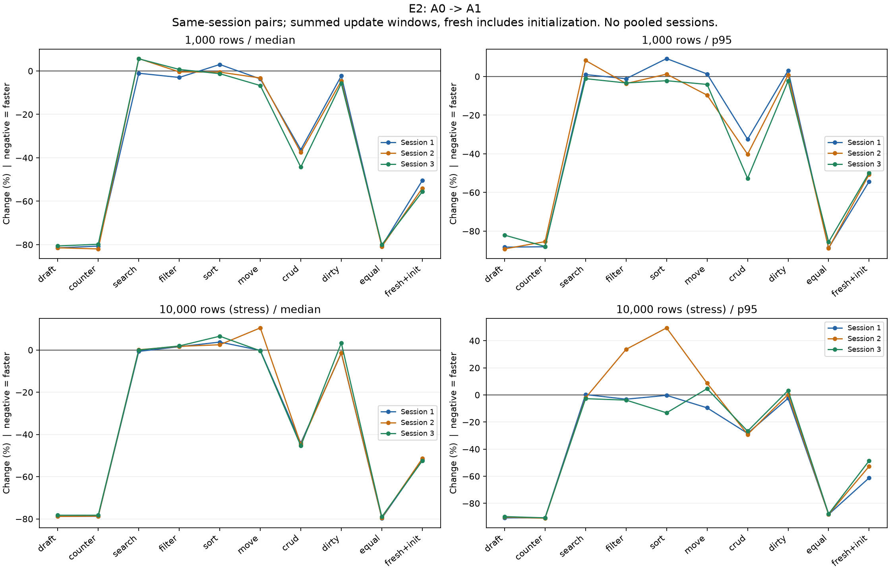
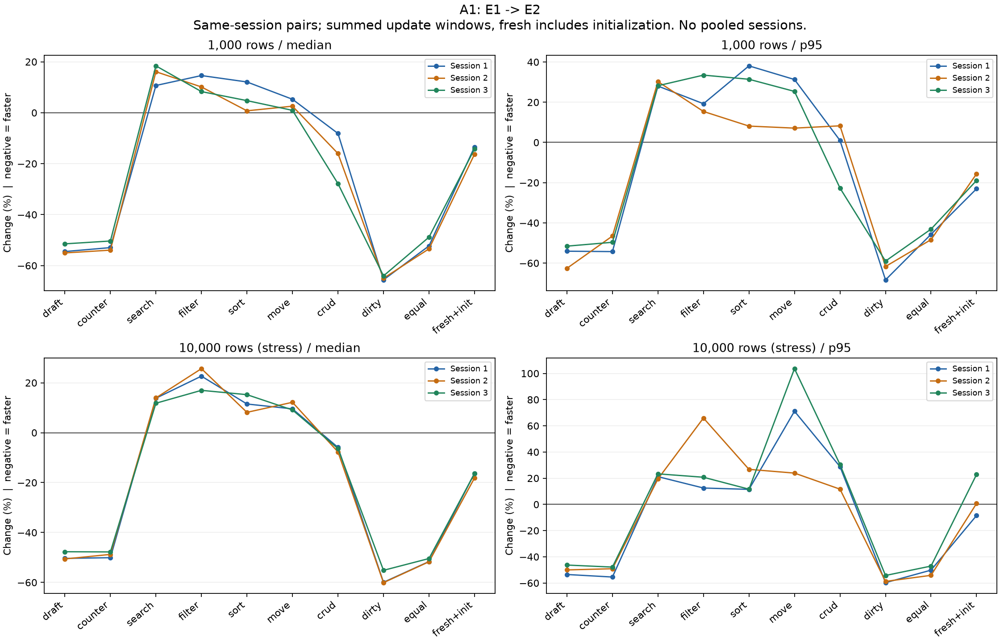

# TaskApp 여섯 조합의 첫 정식 결과

2026-11-08의 `task-matrix-v1` 결과다. E0/E1/E2 × A0/A1, 10/100/1,000/10,000개, 3세션을 모두 완료했다. 현재 단계는 원인 진단이며 최종 엔진 정책의 채택 결과는 아니다. [사전 기준](task-app-comparison-plan.md), [전체 세션별 median/IQR/p95/n](bench/task-matrix-v1/all-results.md), [앱·엔진별 모든 비교](bench/task-matrix-v1/comparisons.md), [원본 독립 감사](bench/task-matrix-v1/statistics-audit.json).

앱 A1의 draft/counter/equal 재사용 목표는 세 엔진 모두 1,000/10,000개에서 세 세션 전부 10% 이상의 median 감소를 확인했다. E2에서 10,000개 counter의 median은 925.50→196.35ms, 907.10→193.30ms, 1,120.10→243.40ms였다. row 실행 0회와 실제 시간 감소를 따로 확인한 결과다. 초기화+갱신과 CRUD 묶음도 줄었다. 다만 목록이 바뀌는 모든 작업까지 개선됐다고 해석하지 않는다.

아래는 총 갱신 처리 구간 합계의 세션별 변화율이다. 음수는 개선, 양수는 악화다. 유지 조건 n=60, fresh n=30이며 세션을 합치지 않았다. 실제 ms·IQR·모든 크기와 CRUD 하위 action은 위 전체 표에 있다.

| 고정 축 / 비교 | 조건 | median 변화 S1 / S2 / S3 | p95 변화 S1 / S2 / S3 |
|---|---|---:|---:|
| E2 고정, A0→A1 | counter / 10,000 | −78.78% / −78.69% / −78.27% | −90.70% / −90.99% / −90.71% |
| E2 고정, A0→A1 | CRUD / 10,000 | −44.06% / −44.65% / −45.39% | −28.37% / −29.14% / −26.74% |
| E2 고정, A0→A1 | sort / 10,000 | +3.76% / +2.49% / +6.55% | −0.32% / +49.46% / −13.21% |
| A1 고정, E1→E2 | counter / 10,000 | −50.08% / −48.77% / −47.77% | −55.45% / −49.11% / −47.85% |
| A1 고정, E1→E2 | search / 1,000 | +10.69% / +16.09% / +18.40% | +28.04% / +30.24% / +28.20% |
| A1 고정, E1→E2 | search / 10,000 | +13.82% / +13.95% / +11.81% | +21.19% / +19.40% / +23.33% |
| A1 고정, E1→E2 | move / 10,000 | +9.55% / +12.18% / +9.12% | +71.15% / +23.90% / +103.64% |
| A1 고정, E1→E2 | fresh 초기화+equal / 10,000 | −16.28% / −18.14% / −16.33% | −8.50% / +0.70% / +22.84% |

E2는 반복 재사용에서 E1보다 빨랐지만, 새 목록을 평가하는 검색·필터·정렬·이동의 생성 포함 총시간과 p95가 악화됐다. 10,000개 move의 p95는 S3에서 1,257.84→2,561.44ms였다. CRUD 전체 median이 좋아도 rename/toggle 등 하위 action의 회귀가 있으므로 묶음 합계만으로 채택하지 않는다. fresh 전체 median 개선도 초기화 p95 회귀를 상쇄했다고 간주하지 않는다.

정식 측정의 A1 sort/10,000 구간별 median은 다음과 같다(ms, 각 셀 S1/S2/S3). render에는 root expression과 VDOM 평가·정규화·검증이 들어 있다. 파생 VDOM은 render−expression이며 순수 할당 시간이 아니다. 중첩 구간이나 각 구간의 median을 더해 전체 median을 만들지 않는다.

| 구간 | E1 median S1 / S2 / S3 | E2 median S1 / S2 / S3 |
|---|---:|---:|
| root expression | 19.10 / 19.10 / 22.40 | 19.00 / 24.20 / 22.50 |
| render | 310.90 / 352.15 / 372.10 | 585.85 / 657.50 / 691.25 |
| 파생 VDOM | 283.05 / 330.25 / 352.80 | 567.20 / 637.75 / 667.60 |
| diff | 264.65 / 322.95 / 329.85 | 132.70 / 151.65 / 167.35 |
| commit | 2033.40 / 2214.25 / 2305.40 | 1899.85 / 2185.10 / 2247.15 |
| Effect | 0.00 / 0.00 / 0.00 | 0.00 / 0.00 / 0.00 |

후속 진단 24개 조건도 수집·분석을 통과했다. E2의 10,000개 sort/CRUD에서는 freezeTree self 표본이 각각 primary 창 합계의 21.20%/34.36%였으며, freezeTree와 getOwnPropertyDescriptor가 상위 할당 stack이었다. 따라서 깊은 증명은 유지하되 임시 경로 guard의 WeakSet 사용, 모든 보조 객체의 장기 증명 등록, 자식 증명 결과의 중복 조회를 줄이는 후보를 검토한다. 이 비중은 sampling 진단의 근사이며 정식 표본의 지연 원인을 전부 설명하지 않는다.

혼합 작업의 강제 GC 진단에서 10,000개 E1/E2의 JS used heap은 mount 후 62.623/70.472MiB, 마지막 작업 후 65.108/129.169MiB, dispose 후 1.920/65.919MiB였다. 두 엔진 모두 DOM nodes와 listeners는 관찰한 초기 수 20/13으로 돌아왔다. 보유 heap 증가가 관찰됐지만 어떤 객체의 소유 경로 때문인지 heap snapshot으로 확정하지 않았으므로 DOM 누수나 특정 WeakSet backing table로 단정하지 않는다. 후보의 같은 수명 진단에서 이 비용도 다시 비교해야 한다.

CPU/할당/GC/long task·모든 heap checkpoint·정의된 click→Paint 기록은 [별도 진단 보고서](bench/task-diagnostic-baseline-v1/diagnostics.md)와 [수치 근거](bench/task-diagnostic-baseline-v1/diagnostic-report-audit.json)에 있다. 정식 timing과 합산하지 않으며, 모든 긴 지연을 GC 탓으로 해석하지 않는다.

사전 기준을 한 세션 이상 초과한 조건 수는 아래와 같다. 조건에는 workload, fresh 초기화/lifecycle, CRUD 하위 action이 각각 들어 있으며 median/p95 열은 겹칠 수 있다. 이를 서로 더하거나 사용자 작업 개수로 해석하지 않는다. [조건·세션별 판정 원본](bench/task-matrix-v1/decisions.json).

| 비교 | gate 대상 조건 | median 초과 조건 | p95 초과 조건 |
|---|---:|---:|---:|
| E0: A0→A1 | 68 | 6 | 4 |
| E1: A0→A1 | 68 | 9 | 7 |
| E2: A0→A1 | 68 | 8 | 5 |
| A1: E1→E2 | 68 | 20 | 25 |

A1에서도 E2의 search/1,000 median, sort/10,000 median·p95 등 초과 조건을 남겼다. 작은 조건과 CRUD 하위 action도 제외하지 않는다. 최종 적용 정책에 해당하는 회귀·tail 불확실성은 원인 진단과 사전 정의한 3세션 n=180 보충으로 판단해야 한다. 현시점에서 A1 전체 경로나 E2 캐시에 대해 회귀 없음·일반 성능 개선을 확정하지 않는다.





두 그림은 모든 세션과 불리한 점을 포함하며 축을 자르지 않았다. 240개 그림 값과 PNG/SVG hash를 원자료로 검산했다. 10,000개는 stress 조건이다. 전체 raw 48,294행, 측정 작업 41,040개/58,320 action, 통계 12,024개를 보존했다. 720개 조건 모두 성공·dispose됐고, 기록된 hidden/unfocused는 0이었다.

시간 이름 `totalCpuMs`는 dispatch closure와 겹치지 않는 후속 flush/Effect의 **경과 시간 합계**다. 버튼·대상 검색 등 공통 어댑터 비용도 포함하며 OS CPU 시간이나 물리 입력→화면 표시 지연은 아니다. 실제 VDOM 생성은 render 안에 포함되어 있고 중첩 phase를 다시 더하지 않는다. 40ms Effect 대기는 settled 경과 시간에 따로 남아 있다. [정확한 경계·프로그램 입력 방식](bench/task-matrix-v1/measurement-boundaries.json).

fresh는 같은 페이지에서 매번 새 앱 root를 mount한다. 각 비교군·조건·세션의 브라우저는 새로 시작하지만 매 fresh 표본이 새 브라우저인 것은 아니다. 유지 조건의 누적 회수 곡선은 초기화·warm-up을 포함한 관찰 궤적이며 일반적인 재사용 손익분기점이나 독립 표본 분포로 다루지 않는다. [누적 경로의 관찰 교차점](bench/task-matrix-v1/recovery.json).

측정 중 다른 테스트·빌드·프로파일러는 실행하지 않았다. 가벼운 문서/분석 도구 편집은 수행했고 OS 백그라운드 부하·온도·주파수는 통제하거나 측정하지 않았다. 세션별 절대 시간 차이를 숨기지 않고 같은 세션의 쌍과 세션별 분포를 공개한다. 과거 no-op 측정과 수치를 합치지 않았다. [원문을 보존한 이전 보고서](benchmark-results-noop.md).

이 문서의 대표 수치·구간 표·gate 개수·진단 예시는 [별도 대조 기록](bench/task-matrix-v1/overview-audit.json)으로 연결했다. 전체 quantile 재계산은 `audit-task-statistics.mjs`, 이 요약문 대조는 `audit-task-overview.mjs`가 담당한다.

같은 저장소 환경에서 고정 소스/asset을 복원하고 고유 tag로 다시 실행할 수 있다. 기존 결과 디렉터리는 덮어쓰지 않는다. typecheck·테스트·build·profiling과 정식 benchmark를 동시에 실행하지 않는다.

```powershell
node scripts/restore-task-builds.mjs docs/bench/task-matrix-v1
node scripts/benchmark-task.mjs --tag=my-task-matrix --builds=task-e0-a0-v1,task-e0-a1-v1,task-e1-a0-v1,task-e1-a1-v1,task-e2-a0-v1,task-e2-a1-v1
node scripts/analyze-task.mjs docs/bench/my-task-matrix
node scripts/compare-task.mjs docs/bench/my-task-matrix
node scripts/audit-task-statistics.mjs docs/bench/my-task-matrix
# Python + matplotlib 환경에서 정적 PNG/SVG 생성 후 값 재검산
python scripts/plot-task.py docs/bench/my-task-matrix
node scripts/audit-task-statistics.mjs docs/bench/my-task-matrix
# 정식 실행 종료 뒤에만 별도 진단
node scripts/diagnose-task.mjs --tag=my-task-diagnostic --source-run=my-task-matrix --builds=task-e1-a1-v1,task-e2-a1-v1 --sizes=1000,10000
node scripts/analyze-task-diagnostics.mjs docs/bench/my-task-diagnostic
node scripts/report-task-diagnostics.mjs docs/bench/my-task-diagnostic
```

현재 Windows에서는 PATH의 Python 3.10이 아니라 Codex runtime의 Python 3.12와 기존 `.validation/plot-deps`의 matplotlib를 사용했다. 다른 환경에서는 해당 plotting 의존성을 준비해야 하며, Node 통계 재계산에는 Python이 필요 없다. 서버 포트는 timing 4178, 진단 4179다.
